# Dustrivo — Северные дороги

Продолжение игры из архива пользователя. Офлайн-игра для Android о перевозке физического груза: пять машин, 48 дорог в шести регионах, доставка и восстановление Лисьего Брода.

## Сборка 0.22 — Вода после шторма

[Скачать APK для Android 8.0+](https://raw.githubusercontent.com/Rokiru/onetime-bot/main/releases/Dustrivo-0.22.apk)

Продолжение «Первого света»: после генератора нужно вернуть воду. Рейс на 600 отображаемых метров использует стартовый ROVER и четыре действия:

1. **Пост на 102-м метре:** остановиться, отпустить газ и держать тормоз 1 с; дождаться открытия.
2. **Подтопленная дорога на 144–228 м:** ровная тяга и тихий ход; можно включить 4L. Вода действительно сопротивляется движению, а затопленный воздухозаборник глушит мотор.
3. **Насосная на 390-м метре:** довезти насос с исправностью ≥70%, остановиться и удерживать тормоз 3 с. Насос снимается с машины и остаётся на площадке.
4. **Водонапорная на 600-м метре:** довезти шкаф управления. Только после успешного завершения в посёлке появляется вода.

Насос и шкаф — разные физические тела с разной массой и собственной графикой. Удары повреждают насос; после установки его состояние больше не меняется от движения машины. Для трёх звёзд нужны оба груза, насос ≥95% и кузов ≥70%.

Запущенная в «Первом свете» мастерская теперь отправляет **выездную бригаду** после брода, на 294-м метре. Остановка с тормозом 2,2 с даёт до +38% кузова и +12% топлива один раз за рейс. При старом сохранении без доставки нового генератора бригада ещё недоступна. Она ремонтирует машину, но не повреждённый насос.

У насосной и водонапорной башни отдельные кэшируемые иллюстрации: трубы, манометр, арматура, бак, лестница и работающая колонка. Переработан экран посёлка: состояние мастерской/насосной и кнопки рейсов видны сразу, общая карта раскрывается отдельно. Кнопки и нижняя область жестов проверены на 640×320, 873×393 и 1000×500.

Новый заезд дороги 3 использует редакцию 22 и отдельную геометрию `water:22`. Прежние 48 ID, покупки, сохранения и геометрия старых заездов сохранены. Приостановленные рейсы 0.20/0.21 продолжаются по своим правилам. Старые победы на дороге 3 автоматически не включают новую насосную.

После «Первого света» кнопка следующего заказа ведёт в новый рейс. Для повторного прохождения: **«Бортовой журнал» → «Посёлок» → «Вернуть воду»**, либо выбери **«Вода после шторма»** в маршрутах.

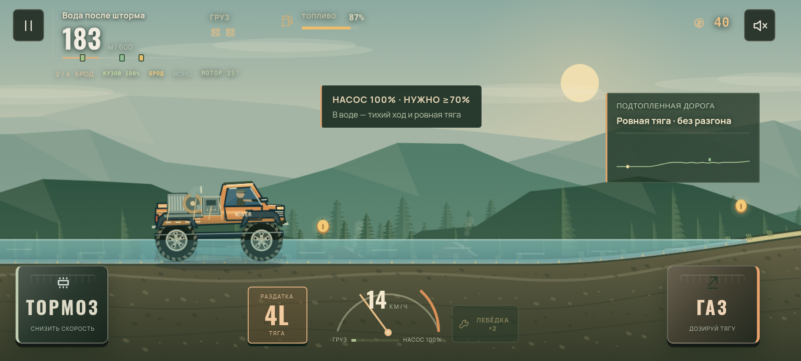
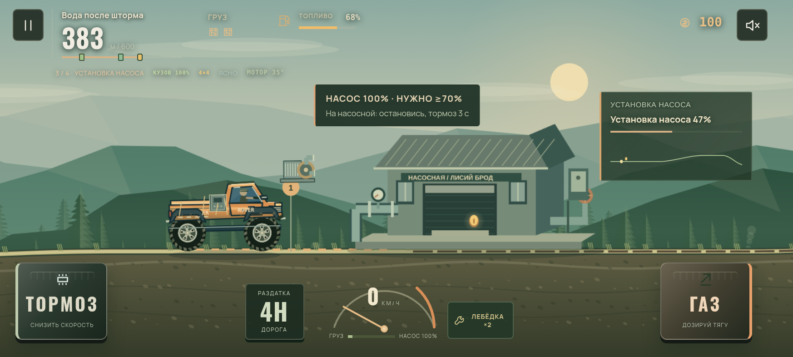
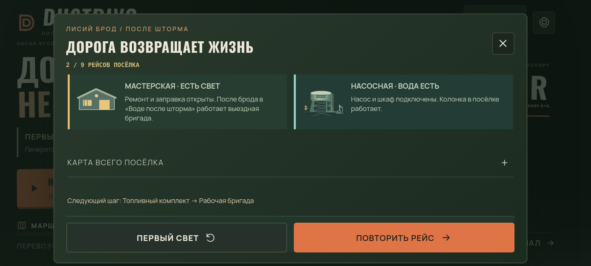

Проверены реальные прохождения, восстановление в воде/во время установки/после разгрузки, поддержка бригады, старые checkpoint-файлы и полная карьера из 48 рейсов. [Отчёт об отрисовке и проверках](docs/performance-0.22.md). Скриншоты и измерения получены в облачном Chromium, не на POCO F5.

## Предыдущая сборка 0.21 — Первый свет

[Скачать APK для Android 8.0+](https://raw.githubusercontent.com/Rokiru/onetime-bot/main/releases/Dustrivo-0.21.apk)

Нажми **«Первый свет ↗»** в главном меню: отвези тяжёлый генератор в мастерскую Лисьего Брода. У указателя через 90 отображаемых метров выбери подвесной мост (480 м, +450 за груз) или лесной объезд (720 м, +420). На время решения физика, бак и часы останавливаются. Выбор сохраняется до конца заезда, в том числе после перезапуска.

Генератор — отдельное физическое тело с двумя креплениями и массой в 4,4 раза больше трёх прежних ящиков вместе. Резкие посадки снижают исправность. Приёмке нужно ≥60%, для трёх звёзд — генератор ≥95% и кузов ≥70%. У короткого пути крутой спуск: в контрольном заезде полный газ оставляет 56%, а торможение перед вершиной позволяет довезти груз целым за 26,3 с. Полный газ по объезду — около 30 с. Это результаты физического тестового водителя, не обещание времени игрока.

После первой успешной доставки у здания загораются окна и освещение бокса, мастерская появляется работающей на карте посёлка. В повторном рейсе остановка у зелёной площадки с удержанием тормоза 2,2 с даёт до +38% кузова и +12% топлива. Для двух дорог сохраняются отдельные рекорды времени и исправности. Старый призрак первого рейса здесь не показывается, поскольку у дорог другая геометрия.

Новые рейсы дороги 0 используют редакцию 21. Прежние 48 ID, покупки и прогресс сохранены; приостановленные заезды продолжаются по своим старым правилам. Старые победы автоматически не включают новую мастерскую. Остальные новые заезды используют контракты 20. Исправлено автосохранение во время частичного нажатия газа.

Новые развилка и итоговый экран учитывают вырез камеры и нижнюю область жестов. Проверены 640×320, 873×393 и 1000×500, выбор дороги/пауза/выход/перезапуск, реальная доставка по обеим веткам, однократная оплата и сохранение мастерской. Полная карьера из 48 физических доставок также пройдена в проверке. Отрисовка сохраняет прежние ограничения DPR и частоты кадров; [измерения облачного рендерера](docs/performance-0.21.md) не заменяют проверку на POCO F5.

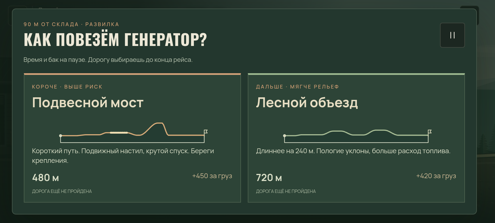
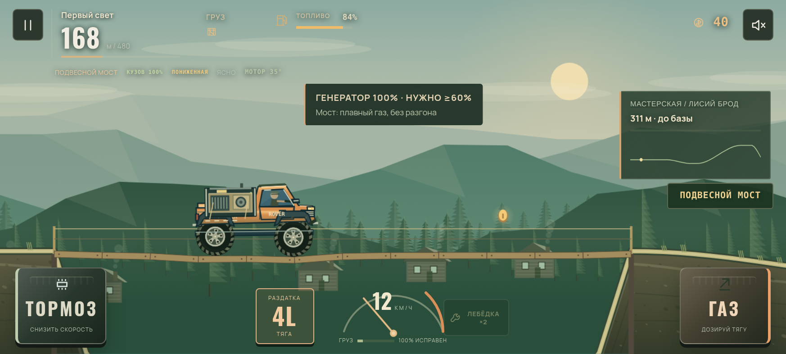
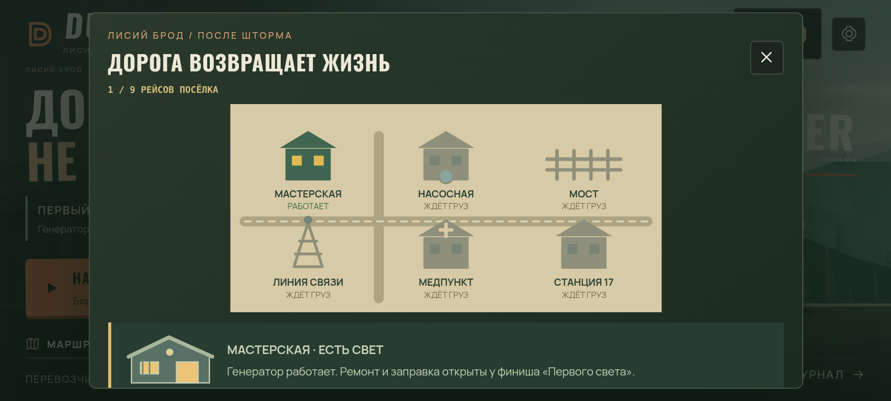

## Предыдущая сборка 0.20

[Скачать APK для Android 8.0+](https://raw.githubusercontent.com/Rokiru/onetime-bot/main/releases/Dustrivo-0.20.apk)

Верхнее затемнение над дорогой убрано. Отгрузка и приёмка, мастерские, медпункты, лесные посты и ёмкости перекачки получили отдельные иллюстрированные здания с площадками, оборудованием, рабочими и вариантами для ночи/снега. Детали здания рисуются один раз в ограниченный кэш, затем используются как спрайты.

При пропущенной обязательной точке появляется крупная стрелка влево, название и расстояние. Удержание тормоза после остановки включает задний ход; при возвращении в зону и удержании тормоза груз выгружается, указатель исчезает.

Мини-карта дороги обновляется с каждым игровым кадром, отдельно от текстового HUD. Исправлен пропуск кадров при небольшом дрожании временных меток RAF. Сохранена цель 60 кадров/с в рейсе и 30 в меню/паузе.

### Рейсы с действиями

- В новом первом рейсе нужно выгрузить один ящик в лесничестве на 150-м отображаемом метре, затем довезти остальные на базу. В «Лесном экспрессе» добавлен промежуточный экспресс-пост.
- На подходящих спусках действует премия +35 монет: скорость не выше 36 отображаемых км/ч, груз цел, жёстких посадок нет. Перед участком появляется подсказка; результаты и премия перечислены в итогах рейса. Условия основаны на реальной скорости/грузе/посадках, а не на нажатии определённой кнопки.
- Премии добавляются к дорожным монетам один раз. Возврат через пройденный участок и восстановление сохранения не дают их повторно.
- Уже сохранённые рейсы 0.17–0.19 продолжаются с прежними условиями. Новые рейсы используют контракт редакции 20; ID дорог, геометрия и карьера сохранены.

### Карточки заказов

Карта использует настоящий профиль земли и координаты точек. На ней отмечены выгрузки, сервисы, шлагбаумы, мосты, броды, разрывы дороги и спуски с премией. Кнопка **«План рейса»** открывает крупную карту с последовательностью остановок и легендой. Компактный список дорог и постоянная кнопка принятия заказа сохранены для телефона.

Сравнение нагрузки с 0.19 приведено в [отчёте](docs/performance-0.20.md). Это облачный Chromium, не замер FPS POCO F5.

### Вождение

- **Чувствительный газ:** нажимай нижнюю часть педали для мягкой тяги; двигай палец вверх для полного газа. Отпускание сбрасывает тягу. На клавиатуре D/стрелка вправо дают полный газ.
- **Раздатка 4H/4L:** кнопка слева от спидометра, либо Q. В 4L крутящий момент выше на 55%, предельная скорость ниже; расход при газе выше на 13%, нагрев немного сильнее. Переключение возможно на земле до 38 отображаемых км/ч, с задержкой между переключениями.
- **Состояние груза:** прибор показывает смещение настоящих физических ящиков и жидкости, а также потерянные ремни.
- Газ/тормоз также регулируют наклон в воздухе. Удержание тормоза на малой скорости включает задний ход. Лебёдка помогает на трудных участках.

### Две новые дороги

**Хребет ветров:** туман, грязь, подвесной мост, доставка на наблюдательный пост и возвращение на базу.

**Каменная лестница:** хрупкая аппаратура в MULE, уступы и подвижные камни, обязательная проверка тормозов. Пониженная передача помогает на каменистом участке.

Исходные 46 дорог и их ID сохранены. Новые дороги добавлены в конец карьеры и доступны в свободной езде. Для нового игрока открывается карьера с нулевым балансом. Существующий выбор профиля и покупки сохраняются.

## Скриншоты

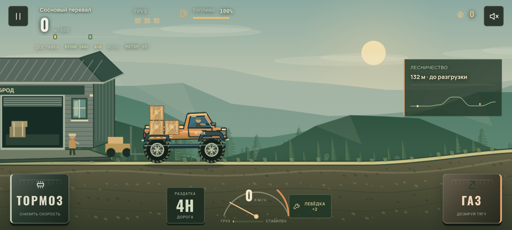
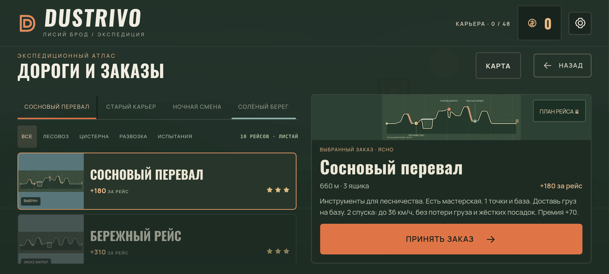
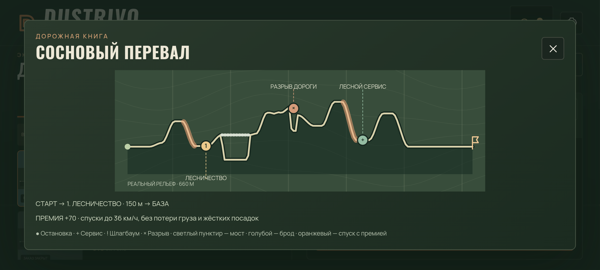
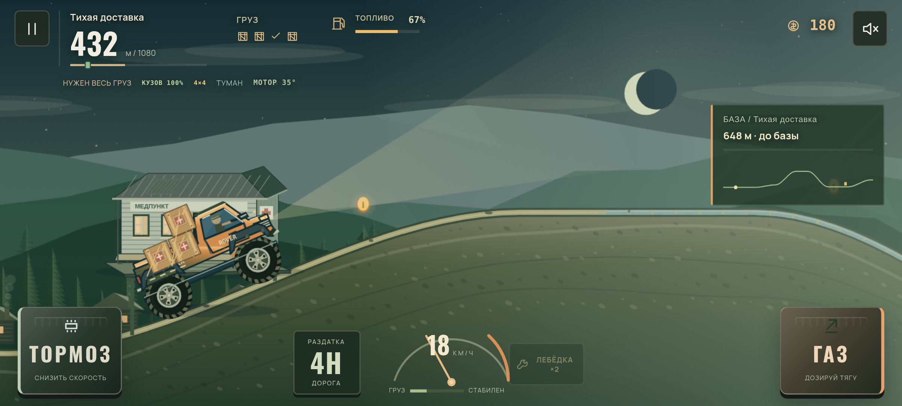
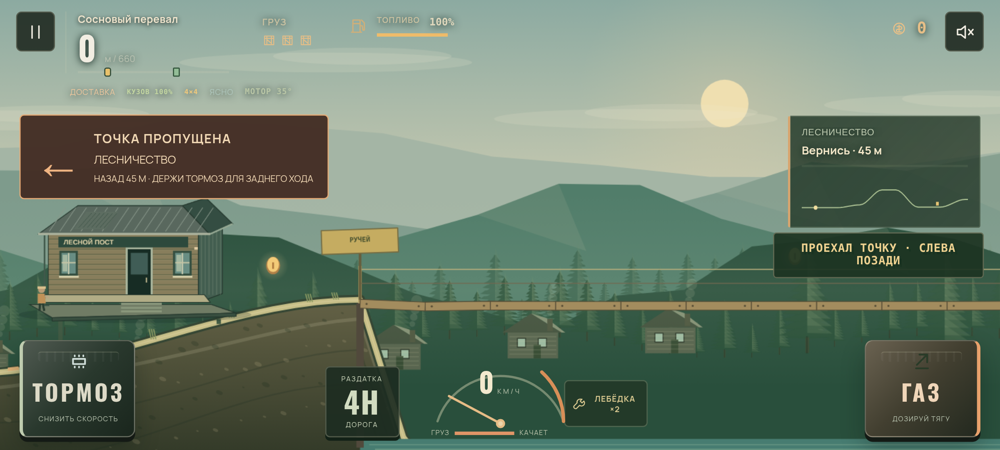

Скриншоты сняты в работающей игре через Chromium, не на Android-телефоне. Медпункт, сервис и приёмка сняты после прохождения дороги физическим тестовым водителем; указатель пропущенной точки проверен отдельным сценарием.

## Сборка

```sh
python3 scripts/bootstrap.py
bash scripts/build-apk.sh
```

Инструменты устанавливаются в игнорируемую `.tools/`: JDK 21.0.8, Android SDK 35, build-tools 35.0.0 и Gradle 8.13. Архивы проверяются по контрольным суммам официальных источников. `scripts/gradle.py` использует существующий прокси и CA среды с проверкой TLS. Сборка запускает проверки механики 0.18, контрактов 0.20 и рейсов 0.21/0.22, `assembleDebug`, Android Lint, проверку подписи, CRC и точного совпадения всех ассетов с исходниками. Результат: `artifacts/Dustrivo-0.22.apk`.

Пакет `ru.rokiru.cargo`, versionCode 23, versionName 0.22, Android 8.0+ и target SDK 35. Игра использует Android System WebView. Интернет-разрешения, рекламы и аналитики нет.

В этой облачной среде APK подписан прежним ключом разработки из предоставленного архива. Ключ и конфигурация подписи хранятся в `.tools/dustrivo-signing/` и **не включены в Git**. Благодаря сохранённым пакету/подписи новая версия может обновлять 0.17–0.21 с сохранением данных. Свежий клон без этого ключа использует другой debug-ключ; он не обновит прежнее приложение без удаления. Ключ для магазина требует отдельной подготовки.

## Проверки

```sh
node tests/verify-expedition18.cjs
node tests/verify-contracts20.cjs
node tests/verify-first-light21.cjs
node tests/verify-water-run22.cjs
CARGO_CHROME=/usr/bin/chromium node tests/verify-water-ui22.cjs
CARGO_CHROME=/usr/bin/chromium node tests/verify-first-light-ui21.cjs
CARGO_CHROME=/usr/bin/chromium node tests/verify-mobile19.cjs
CARGO_CHROME=/usr/bin/chromium node tests/verify-pacing19.cjs
CARGO_CHROME=/usr/bin/chromium node tests/verify-expedition-ui18.cjs
CARGO_CHROME=/usr/bin/chromium node tests/verify-ui16.cjs
CARGO_CHROME=/usr/bin/chromium node tests/verify-career16.cjs
CARGO_CHROME=/usr/bin/chromium node tests/verify-resume17.cjs
CARGO_CHROME=/usr/bin/chromium node tests/verify-checkpoint-cases17.cjs
CARGO_CHROME=/usr/bin/chromium node tests/verify-storage15.cjs
CARGO_CHROME=/usr/bin/chromium node tests/verify-crossings16.cjs
CARGO_CHROME=/usr/bin/chromium node tests/verify-tanker16.cjs
```

Тесты браузера требуют Playwright и Chromium. В текущей среде они установлены. `tests/browser-tools.cjs` запускает и останавливает локальный HTTP-сервер сам. Проверки используют настоящую физику Planck; автоматический водитель существует только в тестах и не включён в APK. Он выбирает пониженную на новых каменистых участках так же, как игрок.

Проверки 0.20: вся карьера из 48 реальных доставок с покупками/выплатой один раз; 14 рейсов с аккуратным прохождением новых спусков; 20 доставок по новым дорогам; старые и новые контрольные точки, точность сохранённого положения/состояния участков, продолжение без скачка на шести дорогах; физическое возвращение к пропущенной остановке; защита премии от повторной выплаты. Интерфейс проверен на размерах от 640×320 до 1000×500 с вырезом/нижним отступом, мультитач и свайп; раскрытие карты/Android Back; карта при 60/90/120 Гц и неровных интервалах кадров; резервное хранилище и сложные контрольные точки.

290 сочетаний прежних дорог/машин и полный прогон из 300 доставок с 918 восстановлениями проверялись при выпуске 0.18. Эти два длительных прогона целиком не повторялись в 0.20.

## Структура

- `game/assets/physics.js` — физика, транспорт и авторские профили дорог.
- `premium-render.js`, `expedition.css`, `expedition-ui.js` — оформление и приборы.
- `depot-art20.js` — кэшируемая архитектура; `journey20.js` — карты заказов и указатели.
- `navigation.js` — ближайшая цель и плавная мини-карта.
- `pedal-input.js` — мультитач и чувствительный газ.
- `run-checkpoint.js` — сохранение физических тел, контактов и раздатки; старые контрольные точки совместимы.
- `game/src/ru/rokiru/cargo/MainActivity.java` — офлайн-хост Android и резервное хранилище.
- `game/README.md` — исходная документация 0.17; исторические версии тестов оставлены для справки.

Planck.js распространяется по MIT; лицензия включена. Шрифты Manrope и Oswald распространяются по SIL Open Font License, тексты лицензий включены в ассеты. Исходный архив сохранён отдельно от checkout; пользовательские ключи не публикуются.
