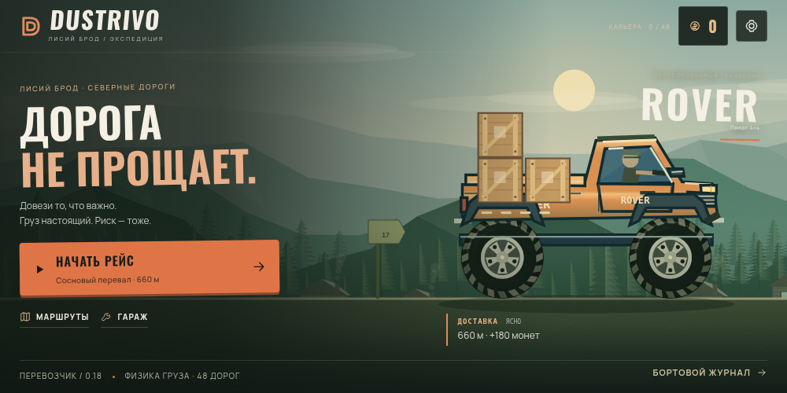
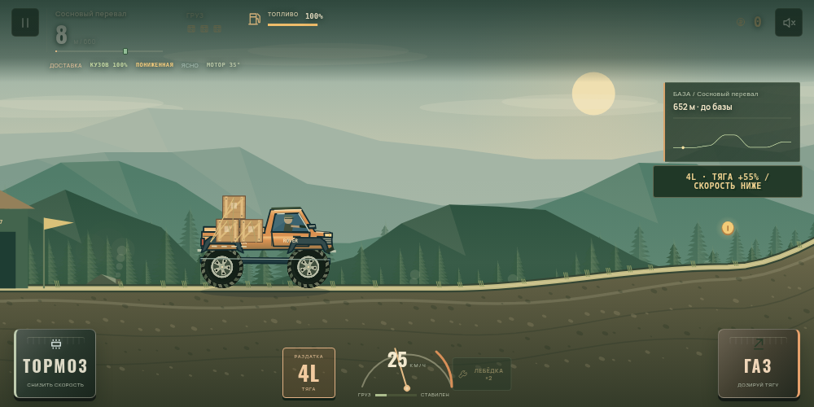
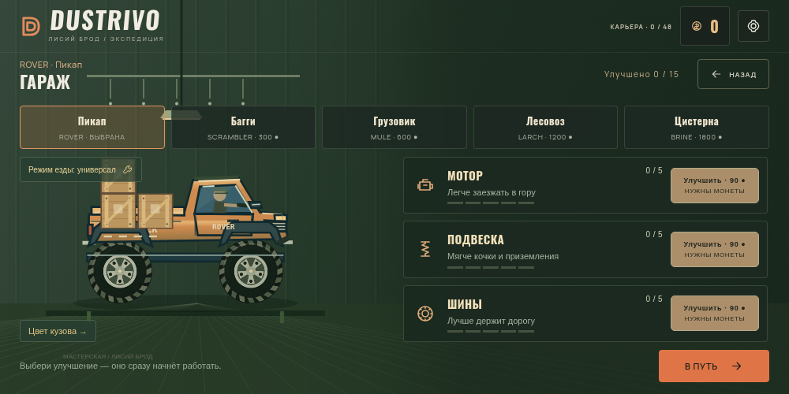
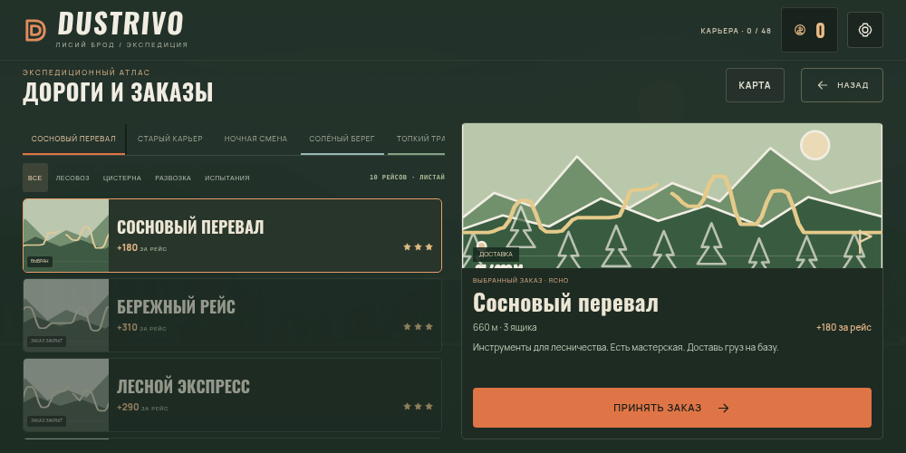

# Dustrivo — Северные дороги

Продолжение игры из архива пользователя. Офлайн-игра для Android о перевозке физического груза: пять машин, 48 дорог в шести регионах, доставка и восстановление Лисьего Брода.

## Сборка 0.19

[Скачать APK для Android 8.0+](https://raw.githubusercontent.com/Rokiru/onetime-bot/main/releases/Dustrivo-0.19.apk)

В этой версии исправлены размещение элементов на телефоне и нагрузка отрисовки:

- Компактный список дорог листается вертикальным свайпом. Выбранная карточка помещается целиком; карта, условия и кнопка принятия заказа находятся в отдельной панели. Длинные условия можно прокрутить, кнопка остаётся видимой.
- Вкладки регионов листаются горизонтально, подписи больше не перекрывают друг друга. Страницы и основные органы управления учитывают вырез экрана и нижний отступ Android.
- Декоративные точки земли объединены в кэшируемые мировые пути; протектор и ступица колеса рисуются из общего спрайта. Убраны полноэкранный шум и размытие под диалогами. Чёткость режимов «Авто» и «Высокое» сохранена.
- Цель отрисовки — 60 кадров/с в рейсе и 30 в меню/паузе. Android запрашивает режим дисплея, ближайший к 60 Гц. Частота экрана 90/120 Гц больше не удваивает работу отрисовки; физика по-прежнему работает с шагом 1/60 с.

Измерения и ограничения сравнения с 0.18 приведены в [отчёте производительности](docs/performance-0.19.md). Это измерения Chromium в облаке; FPS и нагрев POCO F5 ещё не измерены.

Переработаны главный экран, гараж, приборная панель и оформление маршрутных карт. Сдержанная палитра, локальные кириллические шрифты, крупный транспорт, металлические педали и аналоговый спидометр заменяют прежнее оформление. Пейзажи получают новые слои гор, леса, построек и тумана; шины, металл, водитель и загрязнение кузова переработаны. Дорога и груз рисуются по действующей физической модели.

### Вождение

- **Чувствительный газ:** нажимай нижнюю часть педали для мягкой тяги; двигай палец вверх для полного газа. Отпускание сбрасывает тягу. На клавиатуре D/стрелка вправо дают полный газ.
- **Раздатка 4H/4L:** кнопка слева от спидометра, либо Q. В 4L крутящий момент выше на 55%, предельная скорость ниже; расход при газе выше на 13%, нагрев немного сильнее. Переключение возможно на земле до 38 отображаемых км/ч, с задержкой между переключениями.
- **Состояние груза:** прибор показывает смещение настоящих физических ящиков и жидкости, а также потерянные ремни.
- Газ/тормоз также регулируют наклон в воздухе. Удержание тормоза на малой скорости включает задний ход. Лебёдка помогает на трудных участках.

### Две новые дороги

**Хребет ветров:** туман, грязь, подвесной мост, доставка на наблюдательный пост и возвращение на базу.

**Каменная лестница:** хрупкая аппаратура в MULE, уступы и подвижные камни, обязательная проверка тормозов. Пониженная передача помогает на каменистом участке.

Исходные 46 дорог и их ID сохранены. Новые дороги добавлены в конец карьеры и доступны в свободной езде. Для нового игрока открывается карьера с нулевым балансом. Существующий выбор профиля и покупки сохраняются.

## Скриншоты






Скриншоты сняты в работающей игре через Chromium. Они не являются замером производительности Android-устройства.

## Сборка

```sh
python3 scripts/bootstrap.py
bash scripts/build-apk.sh
```

Инструменты устанавливаются в игнорируемую `.tools/`: JDK 21.0.8, Android SDK 35, build-tools 35.0.0 и Gradle 8.13. Архивы проверяются по контрольным суммам официальных источников. `scripts/gradle.py` использует существующий прокси и CA среды с проверкой TLS. Сборка запускает проверки механики 0.18, `assembleDebug`, Android Lint, проверку подписи, CRC и точного совпадения всех ассетов с исходниками. Результат: `artifacts/Dustrivo-0.19.apk`.

Пакет `ru.rokiru.cargo`, versionCode 20, versionName 0.19, Android 8.0+ и target SDK 35. Игра использует Android System WebView. Интернет-разрешения, рекламы и аналитики нет.

В этой облачной среде APK подписан прежним ключом разработки из предоставленного архива. Ключ и конфигурация подписи хранятся в `.tools/dustrivo-signing/` и **не включены в Git**. Благодаря сохранённым пакету/подписи новая версия может обновлять 0.17/0.18 с сохранением данных. Свежий клон без этого ключа использует другой debug-ключ; он не обновит прежнее приложение без удаления. Ключ для магазина требует отдельной подготовки.

## Проверки

```sh
node tests/verify-expedition18.cjs
CARGO_CHROME=/usr/bin/chromium node tests/verify-mobile19.cjs
CARGO_CHROME=/usr/bin/chromium node tests/verify-pacing19.cjs
CARGO_CHROME=/usr/bin/chromium node tests/verify-expedition-ui18.cjs
CARGO_CHROME=/usr/bin/chromium node tests/verify-ui16.cjs
CARGO_CHROME=/usr/bin/chromium node tests/verify-career16.cjs
CARGO_CHROME=/usr/bin/chromium node tests/verify-resume17.cjs
CARGO_CHROME=/usr/bin/chromium node tests/verify-checkpoint-cases17.cjs
CARGO_CHROME=/usr/bin/chromium node tests/verify-storage15.cjs
CARGO_CHROME=/usr/bin/chromium node tests/verify-crossings16.cjs
CARGO_CHROME=/usr/bin/chromium node tests/verify-tanker16.cjs
```

Тесты браузера требуют Playwright и Chromium. В текущей среде они установлены. `tests/browser-tools.cjs` запускает и останавливает локальный HTTP-сервер сам. Проверки используют настоящую физику Planck; автоматический водитель существует только в тестах и не включён в APK. Он выбирает пониженную на новых каменистых участках так же, как игрок.

Проверки 0.19: Android Lint/подпись/CRC/совпадение ассетов, одинаковая подпись с 0.18, интерфейс на 640×320, 747×336, 873×393, 915×412 и 1000×500 с вырезом слева/справа и нижним отступом, настоящие свайпы и аналоговый газ, покупки/перезагрузка сохранений, 48 детерминированных непрозрачных пейзажей, корректное время физики при 60/90/120 Гц, 20 доставок по новым дорогам, сложные контрольные точки и резервное хранилище.

Полная карьера из 48 рейсов, 290 прежних сочетаний дорог/машин, 300 доставок с 918 восстановлениями и 36 рейсов цистерны проверялись при выпуске 0.18. Эти длительные прогоны целиком не повторялись в 0.19.

## Структура

- `game/assets/physics.js` — физика, транспорт и авторские профили дорог.
- `premium-render.js`, `expedition.css`, `expedition-ui.js` — новое оформление и приборы.
- `pedal-input.js` — мультитач и чувствительный газ.
- `run-checkpoint.js` — сохранение физических тел, контактов и раздатки; старые контрольные точки совместимы.
- `game/src/ru/rokiru/cargo/MainActivity.java` — офлайн-хост Android и резервное хранилище.
- `game/README.md` — исходная документация 0.17; исторические версии тестов оставлены для справки.

Planck.js распространяется по MIT; лицензия включена. Шрифты Manrope и Oswald распространяются по SIL Open Font License, тексты лицензий включены в ассеты. Исходный архив сохранён отдельно от checkout; пользовательские ключи не публикуются.
