# Dustrivo — Северные дороги

Продолжение игры из архива пользователя. Офлайн-игра для Android о перевозке физического груза: девять машин, 48 дорог в шести регионах, доставка и восстановление Лисьего Брода.

## Сборка 0.31 — Свой автопарк

[Скачать подписанный APK для Android 8.0+](https://raw.githubusercontent.com/Rokiru/onetime-bot/main/releases/Dustrivo-0.31.apk)

Девять машин: к прежним пяти добавлены фургон RIVET 4×4, вездеход BISON 6×6, лесовоз CEDAR 6×6 и цистерна DELTA 4×4 на 900 л. Разные рамы, оси, ведущие колёса, масса и подвеска; для контрактов можно выбирать любую подходящую купленную модель.

У каждой машины свои шины, подвеска и оборудование с реальными компромиссами; купленные детали переставляются бесплатно. Во вкладке «Стиль» — 12 красок, четыре ливреи и три цвета дисков. Гараж имеет горизонтальную ленту машин и три вкладки мастерской. Оснастка и внешний вид фиксируются при выезде; прежние поездки и покупки сохранены. Гребень остаётся испытанием на штатном ROVER. [Проверки и подробности](releases/NOTES-0.31.md).

## Сборка 0.30 — Плотнее дорога

[Скачать подписанный APK для Android 8.0+](https://raw.githubusercontent.com/Rokiru/onetime-bot/main/releases/Dustrivo-0.30.apk)

45 маршрутов сокращены между ключевыми препятствиями и остановками. Сохранены формы технических секций, глубина бродов и работа с грузом; длинное ровное дно переправ стало короче. Контрольный водитель прошёл все 48 контрактов за **76–119 секунд** на штатной машине с полным грузом. Для новых трасс записаны 144 настоящих эталона; планы рейсов, сохранения и личные рекорды учитывают версию дороги. Гараж сразу выбирает нужную купленную машину.

Сохранённые поездки 0.29 продолжаются на старых трассах. [Подробности и пределы проверки](releases/NOTES-0.30.md). Это APK для личной игры и оценки темпа; публикация в RuStore не выполнялась.

## Предыдущая сборка 0.29 — Рейсы и точная подача

[Скачать подписанный APK для Android 8.0+](https://raw.githubusercontent.com/Rokiru/onetime-bot/main/releases/Dustrivo-0.29.apk)

Один экран рейсов с профилем дороги и подготовкой машины, три раздела меню и выезд/продолжение в одно нажатие. Новые поездки: точная парковка с премией, восемь секунд на возврат после пропущенной остановки, быстрые эвакуации, целостность хрупкого груза и физический пробой цистерны. Дороги сочетают технические участки и подачу; для 48 контрактов и двух загрузок Гребня записаны три эталонных времени механика. Старые сохранения сохраняют прежние правила.

[Изменения, проверки и ограничения 0.29](releases/NOTES-0.29.md). APK для личной проверки на телефоне; в RuStore не опубликован. Осторожные автоматические заезды ещё длиннее целевых 60–120 секунд; удобство пальцами и FPS на Poco F5 требуют проверки игроком.

## Предыдущая сборка 0.28 — Большая серия

[Скачать APK для Android 8.0+](https://raw.githubusercontent.com/Rokiru/onetime-bot/main/releases/Dustrivo-0.28.apk)

«Гребень» вырос до **1290 метров с тремя привалами**. Прежняя трасса остаётся началом серии; дальше — каменные полки и высокий перевал с несколькими посадками подряд. Можно взять один или три физических ящика. Газ поднимает нос в воздухе, тормоз опускает.

На привалах можно сдать оставшийся груз за **100 / 250 / 450 очков за ящик** или продолжить. Полный финиш — **750 за ящик**, плюс прежние бонусы мягких посадок. При аварии очки попытки обнуляются, лучший результат и достигнутая дистанция сохраняются. Перед продолжением машина получает ремонт и топливо; потерянные ящики не возвращаются.

Экран привала показывает настоящий профиль следующего участка, расстояние, сумму для сдачи и цель следующего отрезка. Две прежние кнопки — забрать очки или рискнуть. В HUD виден следующий привал; дополнительных меню нет. Камера новой серии заранее смотрит на рельеф и плавно отдаляется перед перепадом, чтобы было видно место посадки.

Старые рекорды «Гребня» сохранены: начало дороги и первые награды совместимы. Приостановленная старая попытка продолжится на прежних 447 метрах; большая серия начнётся со следующей попытки. Сохранение в любом привале сохраняет выбор и весь груз. История, её 48 дорог, деньги и покупки остаются отдельными от очков «Гребня».

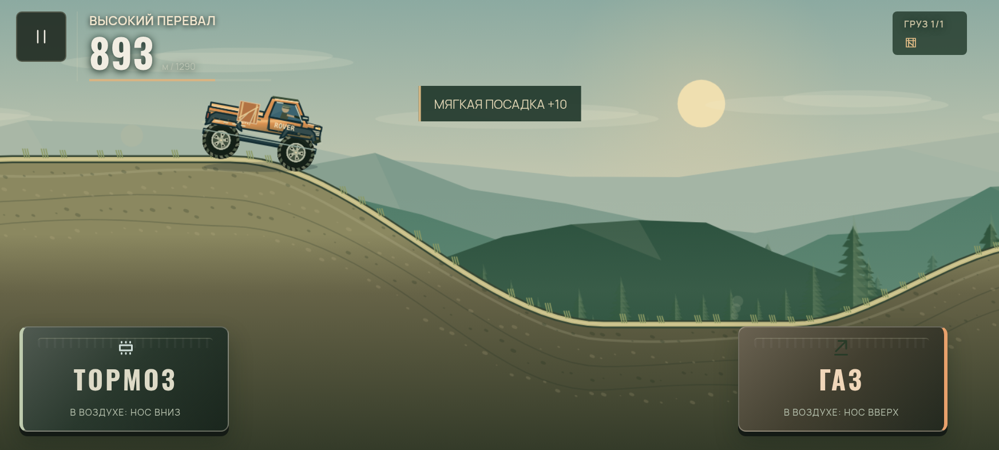
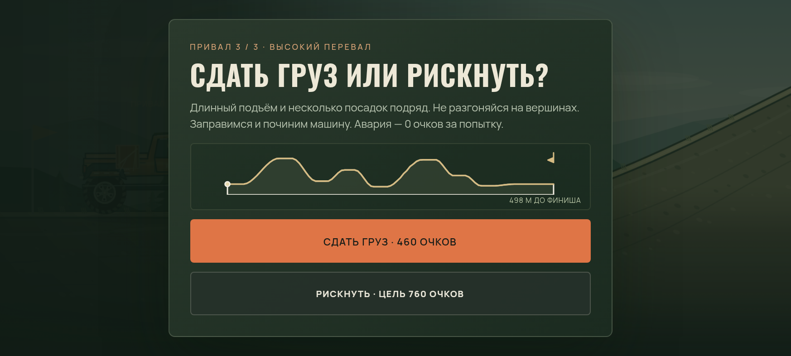

[Проверки и ограничения сборки](docs/validation-0.28.md). APK для личной игры на телефоне; публикация в RuStore не выполнялась.

## Предыдущая сборка 0.27 — Техника езды

[Скачать APK для Android 8.0+](https://raw.githubusercontent.com/Rokiru/onetime-bot/main/releases/Dustrivo-0.27.apk)

Технические участки теперь оценивают реальную сохранность груза: сильную раскачку ящиков/брёвен, сорванные ремни, потерю груза и жёсткие посадки. Ограничения премии «до 36 км/ч» в новых попытках больше нет: быстрый ровный проезд тоже засчитывается. У цистерны учитываются потеря воды и жёсткие посадки; естественное смещение жидкости на склоне не штрафуется. Премия остаётся 35 монет за участок, третья звезда требует пройти их чисто.

Мягкие приземления в истории приносят 5–20 монет в зависимости от оставшегося на машине груза. Нужен настоящий полёт, ровная посадка без повреждений и продвижение дальше по трассе: подпрыгивание на прежнем месте не приносит повторную награду. Премии входят в обычную выплату один раз. Разбивка результата показывает их отдельно; надбавка срочного договора больше не дублируется в строке оплаты груза.

Подсказка заранее учитывает скорость приближения и объясняет потерю премии. При физической аварии результат может показать место и скорость удара или потери груза с советом для следующей попытки. Кнопка повтора сразу начинает тот же заказ, сохраняя выбранную ветку генератора и обычный/срочный договор. То же действует для повтора из паузы.

Добавлен короткий системный виброотклик на посадки и удары. Его можно выключить в «Настройки → Дополнительно»; он также зависит от системных настроек телефона. Новых игровых панелей и графических эффектов нет. Сложные трассы 0.26, физика машин, покупки и рекорды сохранены. Начатые старые рейсы продолжаются по прежним правилам, новая оценка действует со следующей попытки. Короткий «Гребень» сохраняет собственные правила и очки.

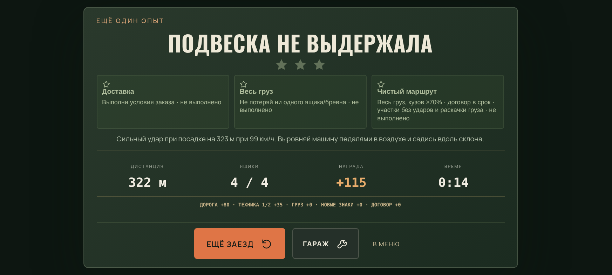
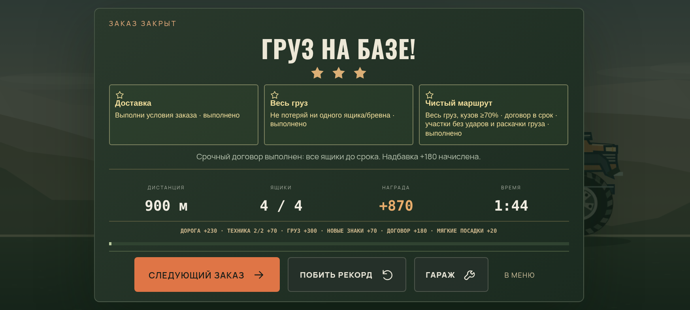

[Проверки и ограничения сборки](docs/validation-0.27.md). APK для личной проверки; публикация в RuStore не выполнялась.

## Предыдущая сборка 0.26 — Дороги с характером

[Скачать APK для Android 8.0+](https://raw.githubusercontent.com/Rokiru/onetime-bot/main/releases/Dustrivo-0.26.apk)

Обновлён рельеф **всех 48 сюжетных маршрутов**. Шесть видов технических участков: острый гребень, двойная волна, тяговый подъём, каменные полки, перелив жидкости на склоне и тяжёлая сцепка. У каждого рейса своё сочетание участков и дорожных задач. На большинстве дорог по два новых участка; на водном рейсе и коротком мостовом пути — по одному.

Теперь нужно готовить скорость перед краем, отпускать газ на вершине, ловить посадку педалями, заранее выбирать 4L и при недостатке тяги пользоваться лебёдкой. Цистерна сохраняет физическую жидкость, лесовоз — брёвна, эвакуация — настоящий фургон и трос. Разгрузки, броды, мосты, посты, камни, ремонт и расход топлива продолжают влиять на прохождение.

Знаки и существующая подсказка показывают ближайшую трудность. На карте рейса отображается новый реальный профиль, гребни, места управления мостами и броды. Удачные спуски приносят прежнюю дорожную премию. Для третьей звезды на новых обычных маршрутах нужно пройти все технические спуски с премией, сохранить груз и кузов. На новых дорогах срочных рейсов 6/8 отведено 130/180 секунд; добровольный срочный договор в карьере по-прежнему требует 1:50. Бригада в новой редакции подливает 24% топлива, поэтому остановка полезнее на длинных рейсах.

Сохранённый старый рейс продолжится на прежнем рельефе. Новый появится со следующей попытки. Покупки, деньги, открытия, звёзды и старые рекорды сохранены; призрак сравнивается только с той же редакцией дороги. У новых трасс отдельные звёзды и рекорды: прежние победы открывают дороги, а отметка «Новый рельеф» предлагает пройти их заново. Рекорды двух новых путей генератора хранятся отдельно. Короткий «Гребень» остаётся отдельным режимом.

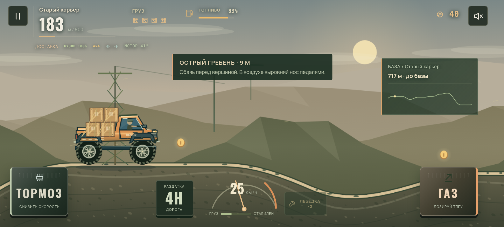
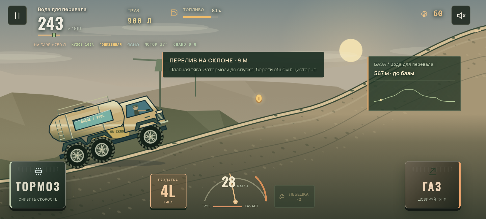
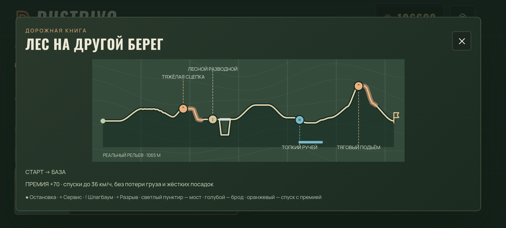

[Проверки и ограничения сборки](docs/validation-0.26.md). Эта версия предназначена для личной проверки игры на телефоне. Публикация в RuStore не выполнялась.

## Предыдущая сборка 0.25 — Гребень

[Скачать APK для Android 8.0+](https://raw.githubusercontent.com/Rokiru/onetime-bot/main/releases/Dustrivo-0.25.apk)

Новый короткий режим с одной машиной и двумя педалями. Выбираешь **один или три физических ящика** и сразу едешь. 447 метров холмов, разрыв и более сложная вторая половина. Газ в воздухе поднимает нос, тормоз опускает; перед посадкой нужно подобрать угол и сбросить лишнюю скорость. Дополнительный груз действительно меняет массу и поведение машины.

На первом привале можно **сдать груз по 100 очков за ящик** или рискнуть и доехать до финиша за **250**. Мягкая посадка добавляет 10 очков за каждый оставшийся ящик. При аварии очки попытки сгорают; рекорд дистанции остаётся. Одна кнопка сразу начинает следующую попытку. Для одного и трёх ящиков отдельные рекорды.

Главный экран теперь состоит из двух вкладок: **Гребень / История**. В коротком заезде видны только дистанция, груз, пауза и педали. В истории основная кнопка сразу начинает или продолжает рейс; маршруты, гараж и посёлок доступны рядом. Редкие настройки убраны в один раскрывающийся блок. Уже начатая история и попытка на Гребне сохраняются отдельно в каждом профиле.

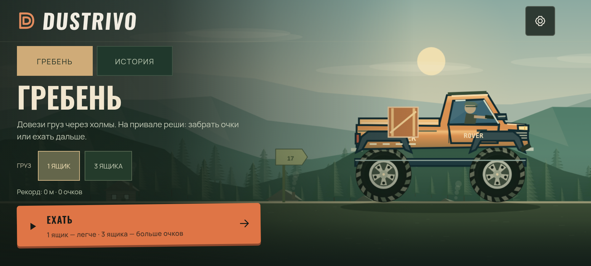
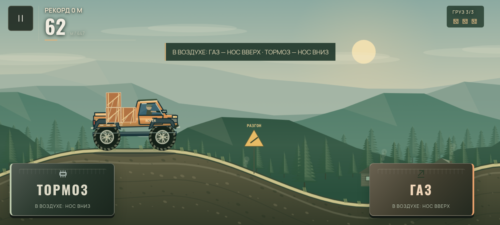
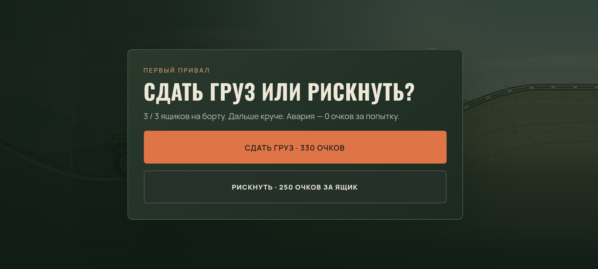

Старые 48 рейсов, покупки, сюжетные флаги и checkpoint-файлы сохранены. Подробности автоматических проверок и их ограничения — в [отчёте 0.25](docs/validation-0.25.md). Подписанный Release сохраняет пакет и прежнюю подпись; публикация в RuStore не выполнялась. Интерес и удобство новой механики ещё нужно оценить живой игрой на телефоне.

## Предыдущая сборка 0.24 — План Лисьего Брода

[Скачать APK для Android 8.0+](https://raw.githubusercontent.com/Rokiru/onetime-bot/main/releases/Dustrivo-0.24.apk)

Первый этап подготовки к закрытому тесту. На главном экране видна текущая цель посёлка. Кнопка **«План посёлка»** открывает девять этапов первой истории: что уже восстановлено, какой груз нужен дальше и какую пользу он принесёт. План сразу прокручивается к следующему этапу; его действия остаются на экране телефона. Старые победы автоматически не включают новые мастерскую, воду или награду механика.

Перед выездом кнопка **«Подготовка»** позволяет бесплатно выбрать Универсал, Бездорожье или Эконом с точными преимуществами и потерями. Здесь же можно явно купить рекомендованное улучшение за заработанные монеты; оно сразу попадёт в физику новой машины. Покупка необязательна. Подготовка приостановленного рейса зафиксирована: его продолжение сохраняет выбранную настройку и договор.

В четвёртом рейсе, **«Старый карьер»**, выбирается договор:

- **Обычный:** до +300 за доставленные ящики, без срока и удержания.
- **Срочный:** все четыре ящика за **1:50** дают надбавку **+180** — до +480 за груз. Опоздание удерживает до **80** из оплаты за груз, не затрагивая собранные монеты и не делая оплату отрицательной. Потеря ящика лишает надбавки. Для трёх звёзд по срочному договору также нужно успеть в срок.

Это влияет на настоящую выплату. Договор закрепляется на выезде и сохраняется после перезапуска. Дополнительные дорожные премии и монеты считаются отдельно. Остальные контракты и старые сохранённые заезды не менялись.

Первое обучение теперь предлагает три практических действия: плавно тронуться, попробовать тормоз и после 25 метров отпустить педали на секунду. Можно пропустить. Незаконченное обучение сохраняется при выборе дороги и перезапуске. После успешного рейса отдельный блок показывает, что доставка дала посёлку.

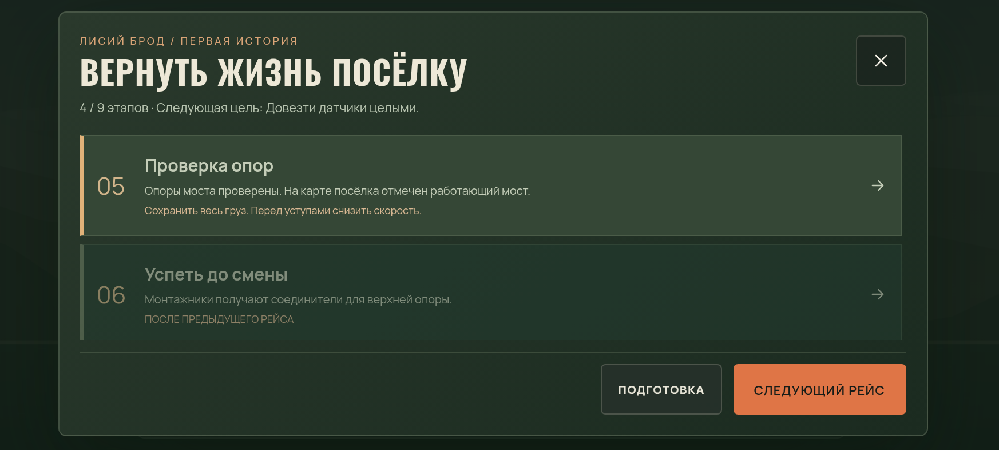
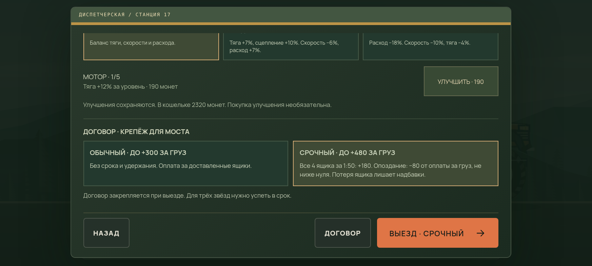
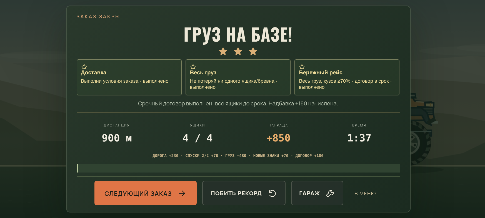

Проверены реальные первые четыре доставки на трёх телефонных размерах, сенсорное обучение, покупка/настройка, надбавка и удержание, восстановление договора, пауза/возвращение через Android JS hooks и все 48 рейсов карьеры. Старые checkpoint-файлы 0.23 продолжаются по прежним траекториям. [Подробности проверки](docs/validation-0.24.md).

Доставленная сборка — **Release без отладочного флага**, пакет и подпись прежние. Это сборка для проверки, публикация в RuStore не выполнялась. Подготовлены [сценарий живого теста](docs/release/playtest-0.24.md) и [черновик страницы магазина](docs/release/rustore-draft.md). Результаты реальных людей, FPS/нагрев телефонов и обновление на Android ещё нужно проверить на устройствах.

## Предыдущая сборка 0.23 — Своих не бросаем

[Скачать APK для Android 8.0+](https://raw.githubusercontent.com/Rokiru/onetime-bot/main/releases/Dustrivo-0.23.apk)

Третий связанный рейс после генератора и воды — эвакуация сломанного фургона механика. Около 570 отображаемых метров на стартовом ROVER: остановись рядом с фургоном сзади, нажми **«Прицепить»**, вытяни его через подъёмы и спуск, поставь на площадку **P** у ремонтной базы и **«Отцепи»**, когда обе машины остановились. Кнопка сцепки занимает место лебёдки; дополнительные маленькие кнопки не нужны. В кузове также нужно сохранить инструмент.

У фургона собственные шасси, подвеска, два колеса и масса. Трос ограничивает расстояние между настоящими креплениями, натяжение показывается на экране, перегрузка может оборвать его. Можно остановиться, вернуться и прицепиться снова. Питающаяся мастерская даёт усиленный трос для буксировки. Для сдачи нужно ≥40% исправности фургона, для трёх звёзд — ≥60%, инструмент цел, кузов ROVER ≥70% и ни одного обрыва. В контрольном заезде аккуратная буксировка сохранила 64%, быстрая — 49%; это результаты физического тестового водителя.

За спасение механик выдаёт **запасной трос: 3 использования обычной лебёдки вместо 2 в следующих новых рейсах**. Старые победы на дороге 4 автоматически награду не дают. Посёлок показывает спасённый фургон и новый бонус; камера отдалена и смещена, чтобы видеть сцепку. При торможении на приёмке машина удерживается на месте и не начинает сама сдавать назад.

Как найти: после «Воды после шторма» нажми **«Следующий заказ»**. Для повторного рейса: **«Бортовой журнал» → «Посёлок» → «Спасти фургон»**, либо выбери **«Своих не бросаем»** в маршрутах. Приостановленные старые рейсы, покупки и все 48 ID сохранены; новую геометрию `recovery:23` используют только новые попытки дороги 4.

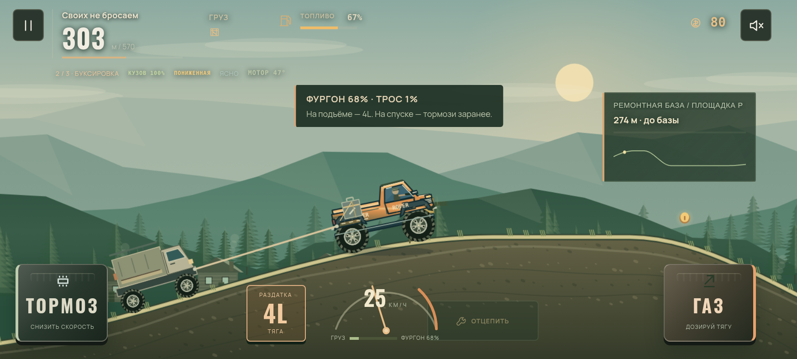
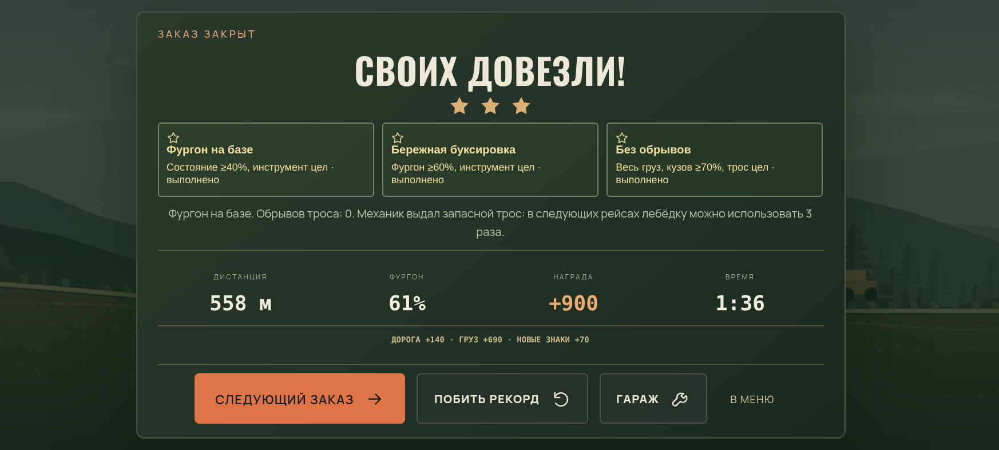
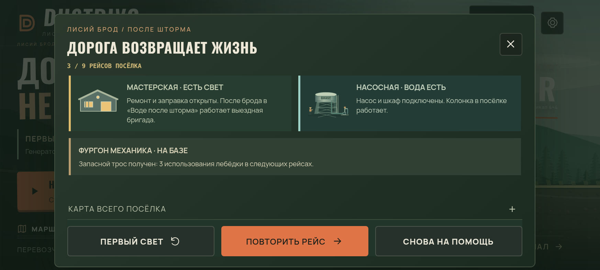

Проверены три связанные главы, сцепка/расцепка настоящими сенсорными кнопками, перезапуск при отцепленном/прицепленном фургоне, сохранение троса на подъёме/спуске/приёмке, старые checkpoint-файлы 0.22 и полная карьера из 48 доставок. [Измерения и подробности](docs/performance-0.23.md). Облачные проверки не измеряют FPS на POCO F5.

## Предыдущая сборка 0.22 — Вода после шторма

[Скачать APK для Android 8.0+](https://raw.githubusercontent.com/Rokiru/onetime-bot/main/releases/Dustrivo-0.22.apk)

Продолжение «Первого света»: после генератора нужно вернуть воду. Рейс на 600 отображаемых метров использует стартовый ROVER и четыре действия:

1. **Пост на 102-м метре:** остановиться, отпустить газ и держать тормоз 1 с; дождаться открытия.
2. **Подтопленная дорога на 144–228 м:** ровная тяга и тихий ход; можно включить 4L. Вода действительно сопротивляется движению, а затопленный воздухозаборник глушит мотор.
3. **Насосная на 390-м метре:** довезти насос с исправностью ≥70%, остановиться и удерживать тормоз 3 с. Насос снимается с машины и остаётся на площадке.
4. **Водонапорная на 600-м метре:** довезти шкаф управления. Только после успешного завершения в посёлке появляется вода.

Насос и шкаф — разные физические тела с разной массой и собственной графикой. Удары повреждают насос; после установки его состояние больше не меняется от движения машины. Для трёх звёзд нужны оба груза, насос ≥95% и кузов ≥70%.

Запущенная в «Первом свете» мастерская теперь отправляет **выездную бригаду** после брода, на 294-м метре. Остановка с тормозом 2,2 с даёт до +38% кузова и +12% топлива один раз за рейс. При старом сохранении без доставки нового генератора бригада ещё недоступна. Она ремонтирует машину, но не повреждённый насос.

У насосной и водонапорной башни отдельные кэшируемые иллюстрации: трубы, манометр, арматура, бак, лестница и работающая колонка. Переработан экран посёлка: состояние мастерской/насосной и кнопки рейсов видны сразу, общая карта раскрывается отдельно. Кнопки и нижняя область жестов проверены на 640×320, 873×393 и 1000×500.

Новый заезд дороги 3 использует редакцию 22 и отдельную геометрию `water:22`. Прежние 48 ID, покупки, сохранения и геометрия старых заездов сохранены. Приостановленные рейсы 0.20/0.21 продолжаются по своим правилам. Старые победы на дороге 3 автоматически не включают новую насосную.

После «Первого света» кнопка следующего заказа ведёт в новый рейс. Для повторного прохождения: **«Бортовой журнал» → «Посёлок» → «Вернуть воду»**, либо выбери **«Вода после шторма»** в маршрутах.


Проверены реальные прохождения, восстановление в воде/во время установки/после разгрузки, поддержка бригады, старые checkpoint-файлы и полная карьера из 48 рейсов. [Отчёт об отрисовке и проверках](docs/performance-0.22.md). Скриншоты и измерения получены в облачном Chromium, не на POCO F5.

## Предыдущая сборка 0.21 — Первый свет

[Скачать APK для Android 8.0+](https://raw.githubusercontent.com/Rokiru/onetime-bot/main/releases/Dustrivo-0.21.apk)

Нажми **«Первый свет ↗»** в главном меню: отвези тяжёлый генератор в мастерскую Лисьего Брода. У указателя через 90 отображаемых метров выбери подвесной мост (480 м, +450 за груз) или лесной объезд (720 м, +420). На время решения физика, бак и часы останавливаются. Выбор сохраняется до конца заезда, в том числе после перезапуска.

Генератор — отдельное физическое тело с двумя креплениями и массой в 4,4 раза больше трёх прежних ящиков вместе. Резкие посадки снижают исправность. Приёмке нужно ≥60%, для трёх звёзд — генератор ≥95% и кузов ≥70%. У короткого пути крутой спуск: в контрольном заезде полный газ оставляет 56%, а торможение перед вершиной позволяет довезти груз целым за 26,3 с. Полный газ по объезду — около 30 с. Это результаты физического тестового водителя, не обещание времени игрока.

После первой успешной доставки у здания загораются окна и освещение бокса, мастерская появляется работающей на карте посёлка. В повторном рейсе остановка у зелёной площадки с удержанием тормоза 2,2 с даёт до +38% кузова и +12% топлива. Для двух дорог сохраняются отдельные рекорды времени и исправности. Старый призрак первого рейса здесь не показывается, поскольку у дорог другая геометрия.

Новые рейсы дороги 0 используют редакцию 21. Прежние 48 ID, покупки и прогресс сохранены; приостановленные заезды продолжаются по своим старым правилам. Старые победы автоматически не включают новую мастерскую. Остальные новые заезды используют контракты 20. Исправлено автосохранение во время частичного нажатия газа.

Новые развилка и итоговый экран учитывают вырез камеры и нижнюю область жестов. Проверены 640×320, 873×393 и 1000×500, выбор дороги/пауза/выход/перезапуск, реальная доставка по обеим веткам, однократная оплата и сохранение мастерской. Полная карьера из 48 физических доставок также пройдена в проверке. Отрисовка сохраняет прежние ограничения DPR и частоты кадров; [измерения облачного рендерера](docs/performance-0.21.md) не заменяют проверку на POCO F5.


## Предыдущая сборка 0.20

[Скачать APK для Android 8.0+](https://raw.githubusercontent.com/Rokiru/onetime-bot/main/releases/Dustrivo-0.20.apk)

Верхнее затемнение над дорогой убрано. Отгрузка и приёмка, мастерские, медпункты, лесные посты и ёмкости перекачки получили отдельные иллюстрированные здания с площадками, оборудованием, рабочими и вариантами для ночи/снега. Детали здания рисуются один раз в ограниченный кэш, затем используются как спрайты.

При пропущенной обязательной точке появляется крупная стрелка влево, название и расстояние. Удержание тормоза после остановки включает задний ход; при возвращении в зону и удержании тормоза груз выгружается, указатель исчезает.

Мини-карта дороги обновляется с каждым игровым кадром, отдельно от текстового HUD. Исправлен пропуск кадров при небольшом дрожании временных меток RAF. Сохранена цель 60 кадров/с в рейсе и 30 в меню/паузе.

### Рейсы с действиями

- В новом первом рейсе нужно выгрузить один ящик в лесничестве на 150-м отображаемом метре, затем довезти остальные на базу. В «Лесном экспрессе» добавлен промежуточный экспресс-пост.
- На подходящих спусках действует премия +35 монет: скорость не выше 36 отображаемых км/ч, груз цел, жёстких посадок нет. Перед участком появляется подсказка; результаты и премия перечислены в итогах рейса. Условия основаны на реальной скорости/грузе/посадках, а не на нажатии определённой кнопки.
- Премии добавляются к дорожным монетам один раз. Возврат через пройденный участок и восстановление сохранения не дают их повторно.
- Уже сохранённые рейсы 0.17–0.19 продолжаются с прежними условиями. Новые рейсы используют контракт редакции 20; ID дорог, геометрия и карьера сохранены.

### Карточки заказов

Карта использует настоящий профиль земли и координаты точек. На ней отмечены выгрузки, сервисы, шлагбаумы, мосты, броды, разрывы дороги и спуски с премией. Кнопка **«План рейса»** открывает крупную карту с последовательностью остановок и легендой. Компактный список дорог и постоянная кнопка принятия заказа сохранены для телефона.

Сравнение нагрузки с 0.19 приведено в [отчёте](docs/performance-0.20.md). Это облачный Chromium, не замер FPS POCO F5.

### Вождение

- **Чувствительный газ:** нажимай нижнюю часть педали для мягкой тяги; двигай палец вверх для полного газа. Отпускание сбрасывает тягу. На клавиатуре D/стрелка вправо дают полный газ.
- **Раздатка 4H/4L:** кнопка слева от спидометра, либо Q. В 4L крутящий момент выше на 55%, предельная скорость ниже; расход при газе выше на 13%, нагрев немного сильнее. Переключение возможно на земле до 38 отображаемых км/ч, с задержкой между переключениями.
- **Состояние груза:** прибор показывает смещение настоящих физических ящиков и жидкости, а также потерянные ремни.
- Газ/тормоз также регулируют наклон в воздухе. Удержание тормоза на малой скорости включает задний ход. Лебёдка помогает на трудных участках.

### Две новые дороги

**Хребет ветров:** туман, грязь, подвесной мост, доставка на наблюдательный пост и возвращение на базу.

**Каменная лестница:** хрупкая аппаратура в MULE, уступы и подвижные камни, обязательная проверка тормозов. Пониженная передача помогает на каменистом участке.

Исходные 46 дорог и их ID сохранены. Новые дороги добавлены в конец карьеры и доступны в свободной езде. Для нового игрока открывается карьера с нулевым балансом. Существующий выбор профиля и покупки сохраняются.

## Скриншоты


Скриншоты сняты в работающей игре через Chromium, не на Android-телефоне. Медпункт, сервис и приёмка сняты после прохождения дороги физическим тестовым водителем; указатель пропущенной точки проверен отдельным сценарием.

## Сборка

```sh
python3 scripts/bootstrap.py
bash scripts/build-apk.sh
```

Инструменты устанавливаются в игнорируемую `.tools/`: JDK 21.0.8, Android SDK 35, build-tools 35.0.0 и Gradle 8.13. Архивы проверяются по контрольным суммам официальных источников. `scripts/gradle.py` использует существующий прокси и CA среды с проверкой TLS. Сборка запускает модельные проверки 0.18–0.28. При наличии прежней локальной подписи режим auto использует `assembleRelease`/`lintRelease`; без неё собирает отдельный debug-вариант. `DUSTRIVO_BUILD_TYPE=release bash scripts/build-apk.sh` требует настроенную подпись. Проверяются подпись, метаданные, отсутствие debug-флага у Release, CRC и точное совпадение всех ассетов с исходниками. Результат: `artifacts/Dustrivo-0.28.apk`.

Пакет `ru.rokiru.cargo`, versionCode 32, versionName 0.31, Android 8.0+ и target SDK 35. Игра использует Android System WebView. Интернет-разрешения, рекламы и аналитики нет.

В этой облачной среде APK подписан прежним ключом разработки из предоставленного архива. Ключ и конфигурация подписи хранятся в `.tools/dustrivo-signing/` и **не включены в Git**. Пакет и публичный сертификат совпадают с прошлыми APK; проверка обновления поверх 0.23 на устройстве включена в сценарий теста. Свежий клон без этого ключа использует другой debug-ключ; он не обновит прежнее приложение без удаления. Перед публикацией владелец должен подтвердить постоянное использование и резервную копию этого ключа.

## Проверки

```sh
node tests/verify-expedition18.cjs
node tests/verify-contracts20.cjs
node tests/verify-first-light21.cjs
node tests/verify-water-run22.cjs
node tests/verify-recovery23.cjs
node tests/verify-opening24.cjs
CARGO_CHROME=/usr/bin/chromium node tests/verify-opening-ui24.cjs
CARGO_CHROME=/usr/bin/chromium node tests/verify-water-ui22.cjs
CARGO_CHROME=/usr/bin/chromium node tests/verify-first-light-ui21.cjs
CARGO_CHROME=/usr/bin/chromium node tests/verify-mobile19.cjs
CARGO_CHROME=/usr/bin/chromium node tests/verify-pacing19.cjs
CARGO_CHROME=/usr/bin/chromium node tests/verify-expedition-ui18.cjs
CARGO_CHROME=/usr/bin/chromium node tests/verify-ui16.cjs
CARGO_CHROME=/usr/bin/chromium node tests/verify-career16.cjs
CARGO_CHROME=/usr/bin/chromium node tests/verify-resume17.cjs
CARGO_CHROME=/usr/bin/chromium node tests/verify-checkpoint-cases17.cjs
CARGO_CHROME=/usr/bin/chromium node tests/verify-storage15.cjs
CARGO_CHROME=/usr/bin/chromium node tests/verify-crossings16.cjs
CARGO_CHROME=/usr/bin/chromium node tests/verify-tanker16.cjs
```

Тесты браузера требуют Playwright и Chromium. В текущей среде они установлены. `tests/browser-tools.cjs` запускает и останавливает локальный HTTP-сервер сам. Проверки используют настоящую физику Planck; автоматический водитель существует только в тестах и не включён в APK. Он выбирает пониженную на новых каменистых участках так же, как игрок.

Проверки 0.20: вся карьера из 48 реальных доставок с покупками/выплатой один раз; 14 рейсов с аккуратным прохождением новых спусков; 20 доставок по новым дорогам; старые и новые контрольные точки, точность сохранённого положения/состояния участков, продолжение без скачка на шести дорогах; физическое возвращение к пропущенной остановке; защита премии от повторной выплаты. Интерфейс проверен на размерах от 640×320 до 1000×500 с вырезом/нижним отступом, мультитач и свайп; раскрытие карты/Android Back; карта при 60/90/120 Гц и неровных интервалах кадров; резервное хранилище и сложные контрольные точки.

290 сочетаний прежних дорог/машин и полный прогон из 300 доставок с 918 восстановлениями проверялись при выпуске 0.18. Эти два длительных прогона целиком не повторялись в 0.20.

## Структура

- `game/assets/physics.js` — физика, транспорт и авторские профили дорог.
- `premium-render.js`, `expedition.css`, `expedition-ui.js` — оформление и приборы.
- `depot-art20.js` — кэшируемая архитектура; `journey20.js` — карты заказов и указатели.
- `navigation.js` — ближайшая цель и плавная мини-карта.
- `pedal-input.js` — мультитач и чувствительный газ.
- `run-checkpoint.js` — сохранение физических тел, контактов и раздатки; старые контрольные точки совместимы.
- `game/src/ru/rokiru/cargo/MainActivity.java` — офлайн-хост Android и резервное хранилище.
- `game/README.md` — исходная документация 0.17; исторические версии тестов оставлены для справки.

Planck.js распространяется по MIT; лицензия включена. Шрифты Manrope и Oswald распространяются по SIL Open Font License, тексты лицензий включены в ассеты. Исходный архив сохранён отдельно от checkout; пользовательские ключи не публикуются.
